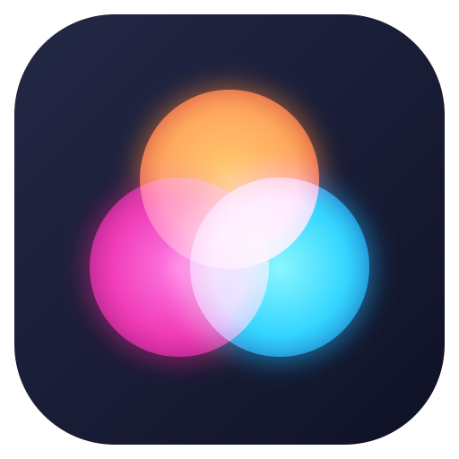
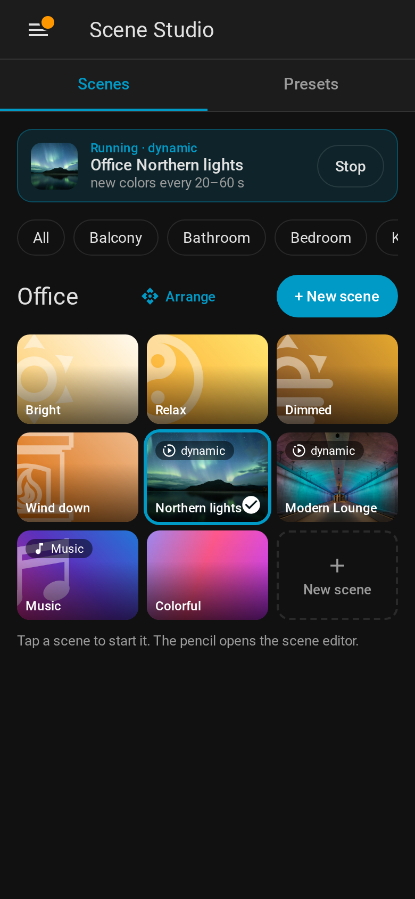
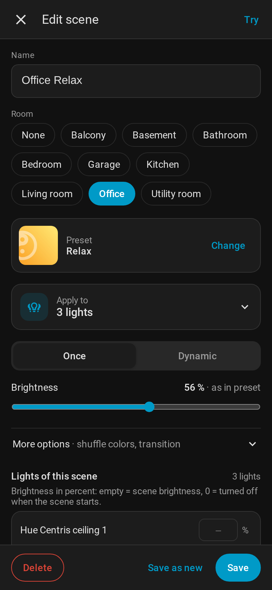
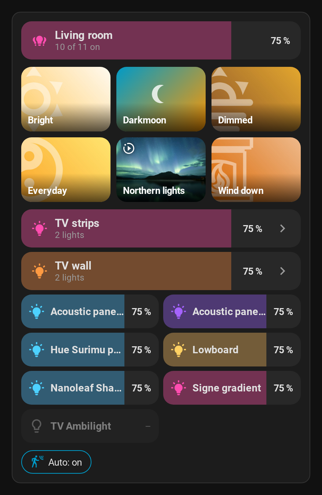
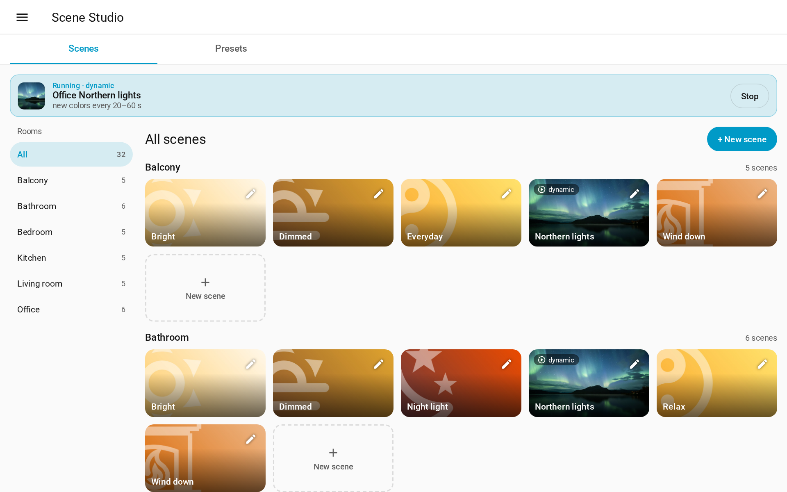

<p align="center"></p>

<h1 align="center">Scene Studio</h1>

Light scenes for **every** light in Home Assistant – no bridge, no vendor lock-in, no account.
Pick one of 120+ color presets or make your own from a photo, save scenes for your rooms, let the
colors drift slowly as dynamic scenes, let the lights follow the album cover of your music and put
each room on your dashboard with the room card.

<table>
  <tr>
    <td width="33%"></td>
    <td width="33%"></td>
    <td width="33%"></td>
  </tr>
  <tr>
    <td align="center">Scenes by room</td>
    <td align="center">Scene editor</td>
    <td align="center">Room card</td>
  </tr>
</table>

## Features

| | |
|---|---|
| **Presets for any light** | 120+ built-in color presets, applied to lights, groups, areas, floors or labels. Lights that can only do white get the matching color temperature. |
| **Saved scenes** | Preset + lights + settings stored in Home Assistant, each one a `scene.*` entity for dashboards, automations and voice. [Saved scenes](https://github.com/andrejem/scene-studio/blob/main/docs/Saved%20scenes.md) |
| **Panel** | Scenes grouped by room, presets with search and favorites, a scene editor, running dynamic scenes at a glance. Phone and desktop, light and dark theme, English and German. [Panel](https://github.com/andrejem/scene-studio/blob/main/docs/Panel.md) |
| **Dynamic scenes** | The colors drift slowly between the lights. With **per-light timing** every light changes on its own schedule. [Per-light timing](https://github.com/andrejem/scene-studio/blob/main/docs/Per-light%20timing.md) |
| **Lights of a scene** | Brightness per light, lights that only join when they are on, lights left out, light groups as one light. [Lights of a scene](https://github.com/andrejem/scene-studio/blob/main/docs/Lights%20of%20a%20scene.md) |
| **Lamp modes** | Give one lamp another scene of the room while the rest keeps going. [Lamp modes](https://github.com/andrejem/scene-studio/blob/main/docs/Lamp%20modes.md) |
| **Music scenes** | The lights take the colors of the album cover that is playing and change with every new cover. They can start by themselves when music starts or follows you into another room, and return to their state before when the music stops. [Music scenes](https://github.com/andrejem/scene-studio/blob/main/docs/Music%20scenes.md) |
| **Presets from photos** | The dominant colors of a photo become a preset – no JSON, no restart. Built-in presets can get another picture. [Scene from photo](https://github.com/andrejem/scene-studio/blob/main/docs/Scene%20from%20photo.md) |
| **Room card** | One card per room: brightness slider, scene tiles with pictures, light rows. Built from the area automatically, visual editor. [Room card](https://github.com/andrejem/scene-studio/blob/main/docs/Room%20card.md) |

## Installation

### HACS

1. In HACS, open the menu (⋮) → **Custom repositories**, add `https://github.com/andrejem/scene-studio`
   with type **Integration**.
2. Search for **Scene Studio** in HACS and download it.
3. Restart Home Assistant.
4. **Settings → Devices & services → Add integration → Scene Studio**.

### Manual

Copy `custom_components/scene_studio` into the `custom_components` folder of your Home Assistant
configuration, restart Home Assistant and add the integration as above.

Requires Home Assistant 2026.7 or newer.

### Coming from Scene Presets?

Scene Studio is a separate integration and can be installed next to Scene Presets. It brings your
saved scenes, own presets and scene entities (with the same entity IDs and areas) over in one step:
[Coming from Scene Presets](https://github.com/andrejem/scene-studio/blob/main/docs/Coming%20from%20Scene%20Presets.md).

## Quick start

1. Open **Scene Studio** in the sidebar and switch to the **Presets** tab.
2. Under **Apply to**, choose a room (area) or a few lights.
3. Tap presets to try them on your lights. **Once** applies the colors, **Dynamic** keeps them moving.
4. Click **Save as scene**, give it a name and a room, **Save**.
5. Your scene is now in the **Scenes** tab and a `scene.*` entity: use it on a dashboard (or add the
   [room card](https://github.com/andrejem/scene-studio/blob/main/docs/Room%20card.md)), in automations or with voice assistants.



## Automations

Every saved scene is a scene entity, so an automation only needs `scene.turn_on`. The scene editor
shows the entity ID with a **Copy** button under *Use in automations*.

```yaml
action: scene.turn_on
target:
  entity_id: scene.living_room_relax
```

All services (`apply_preset`, `start_dynamic_scene`, `save_scene`, `activate_saved_scene`, …) are
described in the [service reference](https://github.com/andrejem/scene-studio/blob/main/docs/Services.md). Preset IDs are listed in the
[preset overview](https://github.com/andrejem/scene-studio/blob/main/custom_components/scene_studio/assets/Readme.md).

## Good to know about dynamic scenes

- A dynamic scene stops by itself once all of its lights are turned off.
- Starting a dynamic scene on a light that is already part of another one stops the other one.
- Lights of a dynamic scene that you turn off are not turned on again by it.
- Many lights with very short intervals can put a lot of load on a Zigbee network.
- Lights react with different delays; a longer transition hides that.
- Dynamic scenes do not survive a restart of Home Assistant (saved scenes do – start them again).
- The first step of a dynamic scene always uses a 0.5 s transition and no smart shuffle, so the
  result is instant and all colors of the preset get into the rotation.

## Documentation

| Page | Content |
|---|---|
| [Panel](https://github.com/andrejem/scene-studio/blob/main/docs/Panel.md) | Scenes tab, presets tab, scene editor |
| [Saved scenes](https://github.com/andrejem/scene-studio/blob/main/docs/Saved%20scenes.md) | Scene entities, saving and editing, services |
| [Lights of a scene](https://github.com/andrejem/scene-studio/blob/main/docs/Lights%20of%20a%20scene.md) | Brightness per light, only if on, leave out, groups as one light, areas |
| [Lamp modes](https://github.com/andrejem/scene-studio/blob/main/docs/Lamp%20modes.md) | Another scene for single lamps of a room |
| [Music scenes](https://github.com/andrejem/scene-studio/blob/main/docs/Music%20scenes.md) | Colors from the album cover, starting by itself, examples |
| [Per-light timing](https://github.com/andrejem/scene-studio/blob/main/docs/Per-light%20timing.md) | Dynamic scenes where every light has its own rhythm |
| [Smart shuffle](https://github.com/andrejem/scene-studio/blob/main/docs/Smart%20Shuffle.md) | How colors are spread over the lights |
| [Scene from photo](https://github.com/andrejem/scene-studio/blob/main/docs/Scene%20from%20photo.md) | Presets from your own photos, other pictures for built-in presets |
| [Custom presets](https://github.com/andrejem/scene-studio/blob/main/docs/Custom%20Presets.md) | Presets as JSON files (for developers) |
| [Room card](https://github.com/andrejem/scene-studio/blob/main/docs/Room%20card.md) | Dashboard card, all options |
| [Services](https://github.com/andrejem/scene-studio/blob/main/docs/Services.md) | All services and their fields |
| [Coming from Scene Presets](https://github.com/andrejem/scene-studio/blob/main/docs/Coming%20from%20Scene%20Presets.md) | Import of scenes, presets and scene entities |

## Credits and license

Scene Studio is based on [Scene Presets](https://github.com/Hypfer/hass-scene_presets) by
[Sören Beye (Hypfer)](https://github.com/Hypfer). The built-in presets, the color logic and the
dynamic scene engine are his work. The pictures of the presets are photos from Unsplash and Wikimedia
Commons, and the colors of each preset are taken from its photo; photographers and licenses are listed
in the [image credits](https://github.com/andrejem/scene-studio/blob/main/custom_components/scene_studio/assets/CREDITS.md).

Licensed under the [Apache License 2.0](https://github.com/andrejem/scene-studio/blob/main/LICENSE); see [NOTICE](https://github.com/andrejem/scene-studio/blob/main/NOTICE) for the attribution and the
list of changes.
