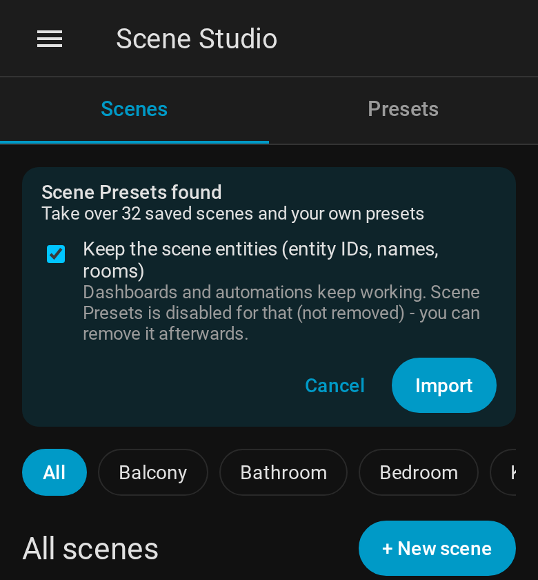

# Coming from Scene Presets

Scene Studio started as a further development of
[Scene Presets](https://github.com/Hypfer/hass-scene_presets). It is a **separate integration**
(domain `scene_studio`): both can be installed at the same time, they do not share services,
storage, panel or cards.

## Import



When Scene Studio finds data of Scene Presets, the panel shows **Scene Presets found** on top
(for admins). **Import** brings over:

- **Saved scenes** (from forks of Scene Presets that have them) with all settings and their IDs
- **Own presets** and replaced pictures of built-in presets (`userdata/custom`)
- with **Keep the scene entities** (default): the scene entities of the saved scenes with the same
  **entity ID, name, icon, area and labels**, so dashboards, automations and voice assistants keep
  working. Scene Presets is **disabled** for that (not removed), otherwise it would create its
  scene entities again.

Favorites, the chosen lights and the settings of the panel are taken over in each browser the first
time Scene Studio is opened there.

The same import is available as a service:

```yaml
action: scene_studio.import_scene_presets
data:
  take_over_entities: true   # default
  overwrite: false           # import scenes and files again that exist already
```

Scenes that were imported before are skipped, so the import can be repeated safely.

## After the import

| Used with Scene Presets | With Scene Studio |
|---|---|
| `scene_presets.apply_preset`, `start_dynamic_scene`, … | `scene_studio.apply_preset`, `start_dynamic_scene`, … (same fields) |
| `type: custom:scene-presets-room-card` | `type: custom:scene-studio-room-card` (same options) |
| Panel *Scene Presets* | Panel *Scene Studio* |
| `scene.*` entities of saved scenes | the same entities (if taken over) |
| Preset IDs | unchanged |

When everything works, remove Scene Presets under **Settings → Devices & services** and in HACS.
Until then you can go back: delete the imported scenes in Scene Studio, then enable Scene Presets
again (the areas of its scene entities have to be set again).
