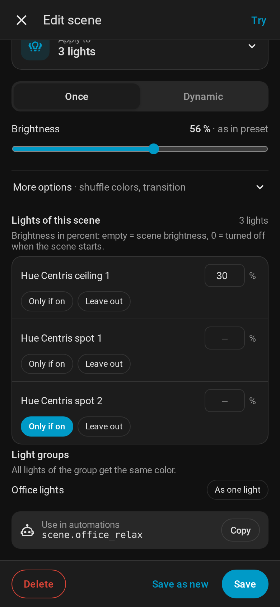

# Lights of a scene

A scene (or a single `apply_preset` / `start_dynamic_scene` call) does not have to treat all lights
the same. In the scene editor, **Lights of this scene** lists every light the scene controls, with
the same rules the services use.



| In the editor | Field | Effect |
|---|---|---|
| Percent field | `light_brightness` | Own brightness for this light, e.g. 5 % for a long LED strip. Empty = scene brightness |
| **Only if on** | `optional` | Takes part only if the light is on when the scene starts, joins later when it is turned on |
| **Leave out** | `exclude` | The scene does not touch this light. Left-out lights are listed with **Add back** |
| **As one light** | `keep_groups` | All lights of a light group get the same color. **Light by light** undoes it |

## Brightness per light, 0 % = off

`light_brightness` maps lights to a brightness in percent (0–100) and overrides the scene
brightness for them – for static and dynamic scenes and for [lamp modes](Lamp%20modes.md).

A light with **0 %** is turned off when the scene starts, so a room looks the same no matter which
scene ran before. This only happens at the start: the light can be turned on again afterwards. An
optional light with 0 % that is turned on joins the scene with the scene brightness. A lamp mode
ignores 0 % and turns the lamp on with the scene brightness. Excluded lights are never touched.

## Areas and exclude

A scene can target a whole area (or device, floor, label) and leave single lights out with
`exclude`. Excluding a light group also excludes its members. New lights in the area are part of
the scene automatically.

When lights come from an area, device, floor or label, Zigbee2MQTT/Govee segment lights
(`*_segment_<n>`) are skipped, otherwise they would fight with their main light. Light groups of the
area are resolved to their members. Lights and groups listed in `entity_id` are used as they are.

## Light groups as one light

With `keep_groups`, a light group is controlled as **one light** instead of light by light: all
members get the same color, and in a dynamic scene the group changes as a whole. Use it for
fixtures that consist of several lights, e.g. two strips left and right of a TV. In the editor,
groups whose lights are all part of the scene are offered under **Light groups**.

## Gradient lamps

Lamps that show several colors at once – Philips Hue gradient lamps like **Signe**, **Play
gradient** or the **gradient light strip** connected to Zigbee2MQTT – get **all colors of the preset
as a gradient** instead of one color. The gradient starts with the color the lamp would get and runs
smoothly through the others (up to 5). In a dynamic scene the gradient changes with every step, in a
[music scene](Music%20scenes.md) the lamp shows the colors of the cover.

Scene Studio finds these lamps by itself in the device list of Zigbee2MQTT; there is nothing to set
up. Home Assistant's light entity knows only one color, so the gradient is sent to Zigbee2MQTT over
MQTT. In the scene editor, gradient lamps are marked *gradient* under **Lights of this scene**, and
**All colors on gradient lamps** switches it off for the scene (`gradient: false`): the lamps then get
one color like any other lamp. Without Zigbee2MQTT (e.g. Hue Bridge) the lamps get one color as before.

## Optional lights

Lights in `optional` take part **only if they are on** when the scene starts. A light that is off
stays off. If it is turned on later (e.g. with a button) while the scene is still active, it joins:

- **Static scene:** it gets a color of the same preset (random, different from its current color).
- **Dynamic scene:** it gets a color of the preset and then changes along with the scene
  (with per-light timing on its own schedule).

The scene counts as active as long as at least one other light of the scene is on and no other
scene was started on the same lights; a dynamic scene must still be running. If the light is
turned on alone in a dark room, it is left as it is. The active scene is kept in memory only, a
restart of Home Assistant forgets it.

Typical use: a decorative panel that is usually off, but should match the room when switched on.

## Example

```yaml
action: scene_studio.save_scene
data:
  name: Living room everyday
  preset_id: e71b2ef3-1b15-4c4b-b036-4b3d6efe58f8
  targets:
    area_id: living_room
  exclude:
    - light.tv_ambilight
  keep_groups:
    - light.tv_wall
  optional:
    - light.deco_panel
  light_brightness:
    light.living_room_strip: 5
    light.reading_lamp: 0
```

`exclude`, `keep_groups`, `optional` and `light_brightness` also work for `apply_preset` and
`start_dynamic_scene`.
