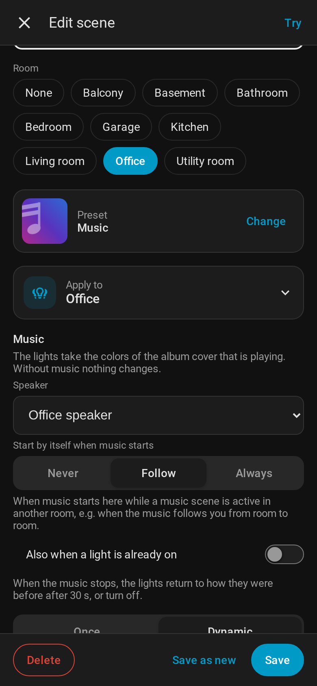

# Music scenes

A music scene lets your lights take the colors of the **album cover** that is playing on a speaker.
A new cover means new colors. When the music stops, the lights go back to how they were before.



## In short

- **Music** is a preset in the category *Basics*. A saved scene with this preset is a music scene.
  There is nothing else to switch on.
- The colors come from the cover that is playing on the speaker of the scene's room (a Sonos if
  there is one). You can also choose another speaker.
- The lights get the **hues** of the cover, but always **vivid**: a muted or pastel cover still
  gives strong colors on the lamps (at least 80 % saturation). **Color intensity** in the scene
  editor makes them paler or even stronger ([Saved scenes](Saved%20scenes.md#color-intensity)).
- With the speaker *Any speaker that is playing* the scene uses the music of every room: in "any"
  mode all Sonos speakers count (without Sonos: all media players).
- **No music, no change.** As long as no cover is known, the lights stay as they are.
- When the music stops (or moves on to another room), the lights return to their state before the
  music scene after 30 seconds. If they were off, they turn off.
- A music scene can also **start by itself** when music starts, for example when the music follows
  you into another room.

## Create a music scene

1. Open **Scene Studio** → **Scenes** → **New scene** in the room you want.
2. Under **Preset**, tap **Change** and choose **Music** (category *Basics*).
3. Choose the lights under **Apply to**, usually the room.
4. Under **Music**, check the settings:
   - **Speaker**: *Automatic* uses the speaker in the scene's room. Choose one if the room has
     several or if the speaker is in another room. *Any speaker that is playing* takes the cover of
     whichever speaker plays – music in the kitchen colors the office too (see below).
   - **Start by itself when music starts**: *Never*, *Follow* or *Always* (see below).
   - **Also when a light is already on**: only shown for *Follow* and *Always*.
5. **Once** or **Dynamic**, brightness and the lights of the scene work as in any other scene. With
   **Dynamic** the cover colors drift slowly between the lights, which looks best with music.
6. **Save**.

The scene gets a *Music* badge in the panel and a note symbol on the room card. It is a normal
`scene.*` entity: dashboards, automations, voice assistants and [lamp modes](Lamp%20modes.md) work
as for every scene.

## What happens when

| Situation | What the lights do |
|---|---|
| You select the scene while music is playing | Colors of the current cover, right away |
| You select the scene while no music is playing | Nothing yet. The colors come with the first cover |
| A new song with a new cover | New colors after about 5 seconds (skipping through songs does not make the lights flicker) |
| A new song with the same cover | The colors move to other lights, so the change is visible |
| A cover without colors (black and white, grey, a radio logo) | The colors stay as they are |
| A cover with only one or two colors | Close shades are added, so a dynamic scene still has something to change between |
| A short pause, e.g. between two songs | Nothing |
| Speaker *Any speaker that is playing*: music in another room | That cover. If several play, the one that started last |
| Speaker *Any speaker that is playing*: that speaker stops, another one still plays | The scene follows the other one instead of ending |
| The music stops or moves to another room | After 30 seconds the lights return to their state before the music scene (also *off*) |
| You select another scene on these lights | The music scene ends, nothing is restored |
| You turn all lights of the scene off | The music scene ends, nothing is restored |
| Home Assistant restarts | Running music scenes are forgotten, like dynamic scenes. Select the scene again |

The lights only return to their state before if the music scene actually changed them.

## Starting by itself

**Start by itself when music starts** decides whether the scene also starts without being selected:

| Option | The scene starts when … |
|---|---|
| **Never** (default) | … you select it. Music alone never changes the lights |
| **Follow** | … music starts on the speaker **and** a music scene is already active in another room |
| **Always** | … music starts on the speaker |

By default it starts by itself only if **no light of the scene is on**. A room that is lit (with
another scene, for reading, …) is left alone. Turn on **Also when a light is already on** if the
music scene should take over anyway.

## Examples

### Music in the living room

*Living room music*: preset **Music**, lights of the living room, **Dynamic**, start by itself
**Never**.

You start a playlist on the living room speaker and tap *Living room music* in the panel or on the
room card. The lights take the colors of the cover and change with every album. When you stop the
music in the evening, the living room goes back to the scene that was on before, 30 seconds later.

### The light follows the music

You use Sonos groups or an integration that moves the music with you from room to room (e.g. a
"follow me" automation based on motion sensors).

- *Living room music*: start by itself **Never** – you start it yourself on the sofa.
- *Kitchen music*, *Bedroom music*, *Office music*: start by itself **Follow**.

You start the music scene in the living room and walk into the kitchen. The music starts on the
kitchen speaker, a music scene is active in the living room, so *Kitchen music* starts as well, if
the kitchen lights are off. When the living room speaker stops, the living room returns to its state
before after 30 seconds. Without an active music scene somewhere, music in the kitchen does not
change the kitchen lights.

### Party

*Party*: preset **Music**, all lights of the living room and the kitchen, **Dynamic** with
[per-light timing](Per-light%20timing.md) (e.g. 5–15 s), start by itself **Always**, **Also when a
light is already on**.

As soon as music plays on the speaker, all these lights follow the covers, no matter what was on
before. When the party is over and the music stops, everything returns to the state before.

### Keep a lamp out of it

A cabinet light, a reading lamp or a light strip that should never be touched: open the scene, tap
**Don't control** next to the lamp under *Lights of this scene* and save. Lights that are not controlled are not turned
on, off or changed – see [Lights of a scene](Lights%20of%20a%20scene.md). With a percentage per
light, a long LED strip can follow the music at 20 % while the other lights are at full brightness.

### The cover once, without a scene

In the **Presets** tab, choose the lights and tap **Music**: the lights take the colors of the cover
that is playing in their room right now, once (or as a dynamic scene with *Dynamic*). They do not
change with the next cover. Without music nothing happens.

The same works in automations with `apply_preset` and the ID of the Music preset:

```yaml
action: scene_studio.apply_preset
data:
  preset_id: b1c7e3d2-2f4a-4c39-9d7e-6a1f0c5e8b42   # Music
  targets:
    area_id: living_room
```

## In automations

A music scene is turned on like any scene:

```yaml
action: scene.turn_on
target:
  entity_id: scene.living_room_music
```

Example: start the music scene when the speaker starts playing in the evening and the room is used:

```yaml
triggers:
  - trigger: state
    entity_id: media_player.living_room
    to: playing
conditions:
  - condition: sun
    after: sunset
actions:
  - action: scene.turn_on
    target:
      entity_id: scene.living_room_music
```

(The same can be done without an automation with **Always**; an automation is useful for extra
conditions like the time of day.)

Saving a music scene with a service – `music` is optional, without `media_player` the speaker of
the room is used:

```yaml
action: scene_studio.save_scene
data:
  name: Kitchen music
  preset_id: b1c7e3d2-2f4a-4c39-9d7e-6a1f0c5e8b42   # Music
  targets:
    area_id: kitchen
  dynamic: true
  interval: 30
  music:
    media_player: media_player.kitchen   # optional; "any": whichever speaker is playing
    auto_start: follow                   # never (default), follow or always
    when_on: false                       # also when a light is already on
```

## Good to know

- Any media player that shows a cover in Home Assistant works (Sonos, Spotify, Apple TV, …). The
  cover is read through Home Assistant, the same picture the media player card shows.
- TV sound, line-in and many radio stations have no cover or just a logo: the lights stay as they
  are.
- The colors are taken from the colorful parts of the cover. Black, white and grey are left out,
  small but strong accents count.
- Lights that can only do white get the matching color temperature, as with every preset.
- A music scene does not turn on a light by itself unless it starts by itself (*Follow* or
  *Always*) – selecting a scene without music changes nothing.
- The panel shows a running music scene with its name and the cover that is playing.
