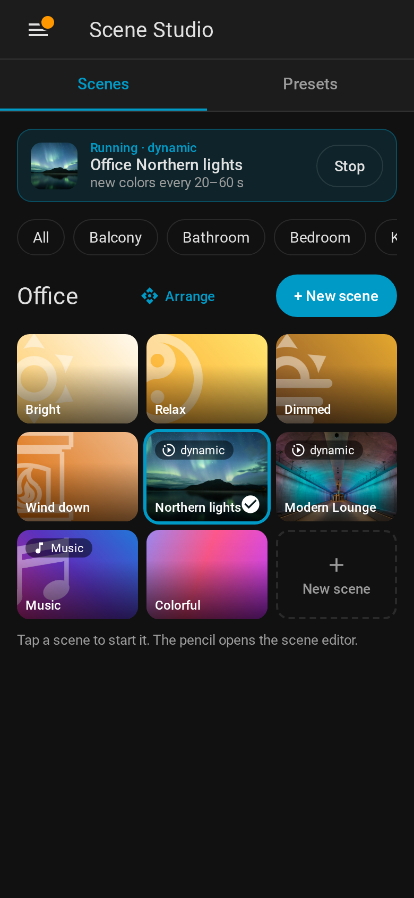
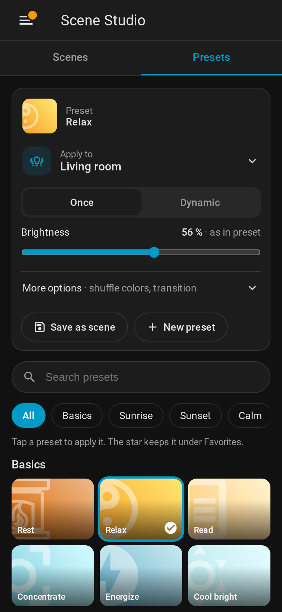
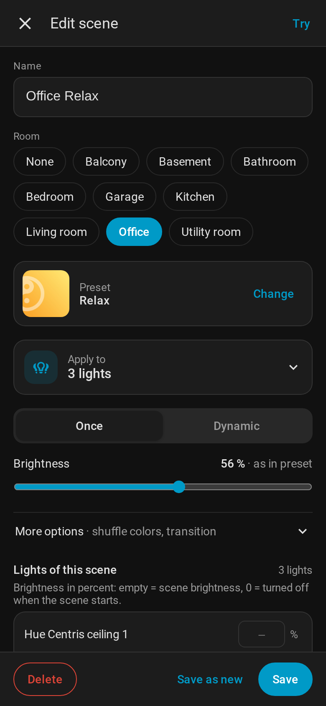
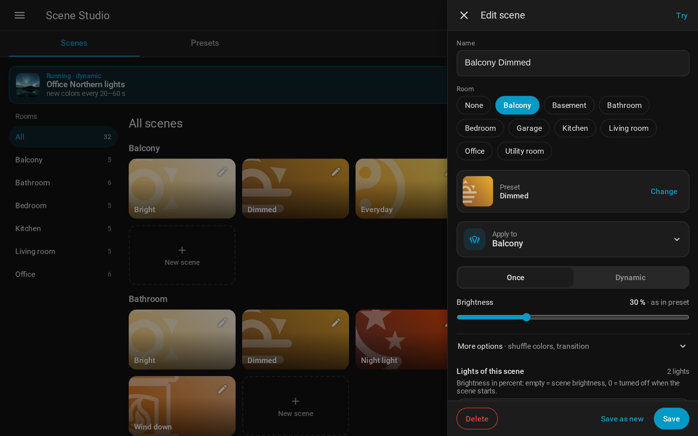
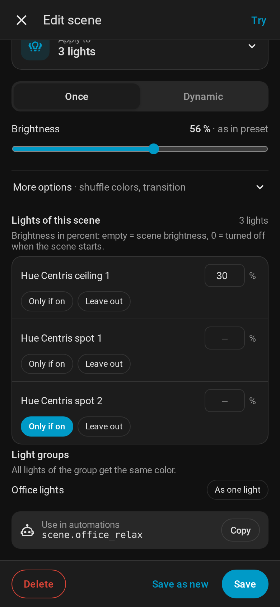

# Panel

Open **Scene Studio** in the Home Assistant sidebar. The panel has two tabs:

- **Scenes** – your saved scenes, grouped by room.
- **Presets** – all presets, to try them on your lights and to save new scenes.

Running dynamic scenes are shown on top of both tabs (*Running · dynamic*) with the time between
color changes and a **Stop** button. A running [music scene](Music%20scenes.md) shows its name and
the cover that is playing.

The panel follows your Home Assistant theme (light or dark) and language (English or German).
On wide screens (900 px and more) the rooms are listed on the left and the scene editor opens as a
side panel; on phones the room chips are on top and the editor fills the screen.

<table>
  <tr>
    <td width="33%"></td>
    <td width="33%"></td>
    <td width="33%"></td>
  </tr>
  <tr>
    <td align="center">Scenes</td>
    <td align="center">Presets</td>
    <td align="center">Scene editor</td>
  </tr>
</table>

## Scenes tab

- Scenes are grouped by **room**: the area of the scene entity. A scene without an area is shown in
  the room its lights belong to, otherwise under *Without room*.
- **All** shows every room; a room chip (or the room list on wide screens) shows one room only.
- On the tiles, the room name at the start of a scene name is left out (*Living room Relax* is shown
  as *Relax* below *Living room*).
- **Tap** a tile to activate the scene. Dynamic scenes have a *dynamic* badge, music scenes a *Music*
  badge.
- The scene that was activated last in a room is **outlined** while lights of the room are on, or
  while it is running as dynamic scene.
- The **pencil** opens the scene editor, **New scene** (button or the dashed tile of a room) creates one.
- **Arrange** (admins, next to the room name): the tiles wiggle, drag them into place with the mouse or
  a finger, then **Done**. **Same order in all rooms** sorts the scenes of every other room the same way,
  matched by the name without the room (*Bright*, *Dimmed*, …); scenes only one room has go to the end.
  The order is stored with the scenes: room cards show the same order, editing a scene keeps its place,
  new scenes come last. (`scene_studio/set_scene_order`, attribute `order` of the scene entities)

## Presets tab

- **Apply to** – the lights the presets are applied to: areas, devices, lights, floors or labels.
  The line shows a short summary; tap it to change the lights.
- **Once / Dynamic** – apply the colors once, or start a dynamic scene that keeps changing them.
- **Brightness** – shows the brightness of the last tapped preset (*as in preset*). Moving the
  slider overrides it (percent); **back to preset** undoes that.
  While you drag, the lights that are on follow the slider (colors stay, lights that are off stay
  off), so you can find the right value; in the scene editor lights with their own percentage keep it.
- **More options**
  - Once: *Shuffle colors*, *Smart shuffle* ([details](Smart%20Shuffle.md)), *Own transition*.
  - Dynamic: *Interval* and *Transition*, or *Per-light timing* with min/max values
    ([details](Per-light%20timing.md)).
  - *Reset settings* restores the defaults.
- **Save as scene** – opens the scene editor with the last tapped preset and these settings.
- **New preset** (admins) – from colors or a photo; the **pencil** on a tile changes a preset – see
  [Own presets](Scene%20from%20photo.md).
- **Search**, category chips and **favorites** (star on a tile) help to find presets. With a mouse,
  star and pencil show when you point at a tile.
- **Hidden presets** (admins, at the end) – built-in presets you hid; the eye shows them again.
- Tap a preset to apply it to the chosen lights. The preset is shown on top of the card with
  *applied*, its tile is outlined and a short message confirms it at the bottom of the screen.

The chosen lights, settings and favorites are remembered in your browser (per device).

## Scene editor

The editor works on its own copy of the scene; the *Presets* tab is not changed by editing.

| Field | Meaning |
|---|---|
| **Name** | Name of the scene and its scene entity. A new scene is named after room and preset (*Bedroom Relax*) until you type a name |
| **Room** | Area of the scene entity (admins). Same as setting the area in the entity settings |
| **Preset** | **Change** opens the preset picker (search, favorites first). The preset **Music** makes it a [music scene](Music%20scenes.md) |
| **Music** | Only with the preset Music: speaker, *Start by itself when music starts*, *Also when a light is already on* |
| **Apply to** | The lights of the scene |
| **Once / Dynamic**, **Brightness**, **More options** | As in the presets tab |
| **Lights of this scene** | Brightness per light, *Only if on*, *Don't control*, groups as one light – see [Lights of a scene](Lights%20of%20a%20scene.md) |
| **All colors on gradient lamps** | Only when the scene has a gradient lamp: off = one color on these lamps too ([gradient lamps](Lights%20of%20a%20scene.md#gradient-lamps)) |
| **Use in automations** | Entity ID of the scene with a **Copy** button |

- **Try** applies the scene to the lights without saving.
- **Save** overwrites the scene (its entity keeps the ID), **Save as new** creates another scene,
  **Delete** removes the scene and its entity.
- Settings of the scene that are not shown are kept when saving.

