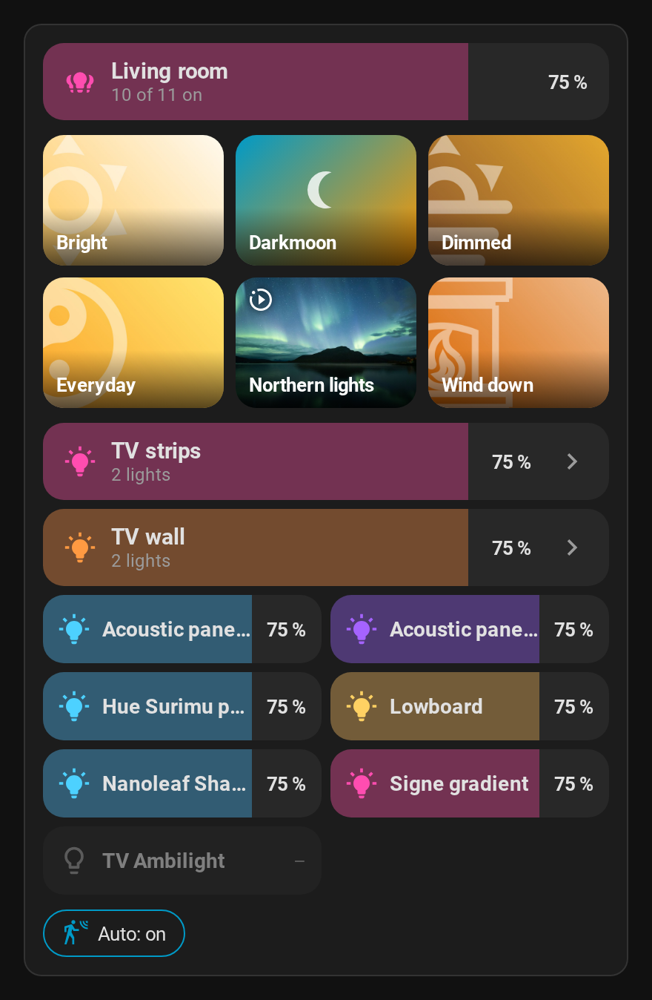
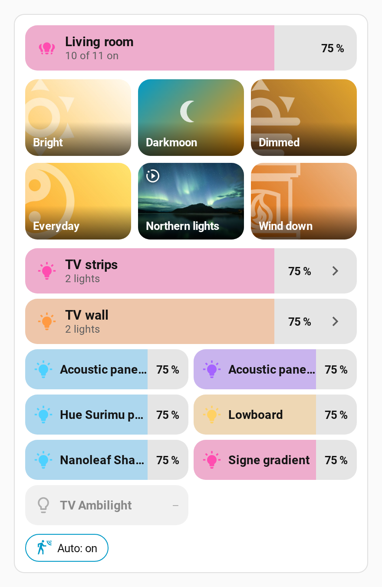

# Room card

 

`custom:scene-studio-room-card` shows one room (Home Assistant area) on a dashboard:

- **Room slider** – tap to switch all lights of the room on/off, drag for brightness, hold for details.
- **Scene tiles** – every `scene.*` entity assigned to the area, with the preset image for saved
  scenes, in the order set with **Arrange** in the panel. Tap activates the scene, **double tap** applies a dynamic saved scene once (static),
  hold opens the details. The active scene is outlined and checked, dynamic scenes show an icon,
  [music scenes](Music%20scenes.md) a note.
- **Light rows** – light helpers (light groups) of the room as full-width rows, expandable (›) to
  their member lights; lights that are not part of a helper get their own row. Single lights are
  shown two per line (`light_columns`). Each row works like the room slider (tap / drag / hold).
- **Auto chip** – the Raumlicht motion switch of the room, if Raumlicht is used. Tapping it turns
  the motion control of the room on or off (the lights themselves are not switched).

The card is loaded by the integration automatically, no dashboard resource is needed. It is built
entirely from the area, so new scenes and lights show up without changing the dashboard.

All options can be set in the **visual editor** (add the card from the card picker or edit it on the
dashboard). Empty lists mean "automatic". The card is shown in English, or in German when Home
Assistant runs in German.

## Configuration

```yaml
type: custom:scene-studio-room-card
area: arbeitszimmer
```

| Option        | Default | Description                                                                 |
|---------------|---------|-----------------------------------------------------------------------------|
| `area`        | –       | Area ID (required)                                                          |
| `name`        | area name | Title of the room slider                                                  |
| `columns`     | 3       | Columns of the scene tiles                                                  |
| `light_columns` | 2     | Columns of the single light rows (groups always use the full width)        |
| `scenes`      | auto    | Explicit list and order of scene entities instead of all scenes of the area. In the visual editor the list offers the scenes of the chosen area |
| `lights`      | auto    | Explicit list of light entities instead of all lights of the area (the editor offers the lights of the area) |
| `hide`        | –       | Entities (lights or scenes) not to show, e.g. motion-only scenes (the editor offers those of the area) |
| `master`      | auto    | Light (group) used for the room slider                                      |
| `structural`  | –       | Additional light groups that are not shown as rows (only their members)     |
| `show_lights` | true    | Show the light rows                                                         |
| `show_auto`   | true    | Show the Raumlicht motion chip                                              |
| `chips`       | –       | Extra entities as chips next to the motion chip, e.g. a cabinet light (tap = toggle, hold = details); usually also listed in `hide` |

## How lights are found

- All `light.*` entities of the area (entity area or device area), except hidden ones, entities
  with an entity category and Zigbee2MQTT/Govee segment lights (`*_segment_<n>`).
- With Raumlicht, the room and ambient light groups of the room are added, so their lights belong
  to the room even if they have no area.
- The room slider uses the Raumlicht room light group, otherwise a group that contains every light
  of the room, otherwise all lights together.
- Groups that contain every light of the room and the Raumlicht room/ambient groups are
  *structural*: they are not shown as rows, the helpers and lights inside them are.

## Raumlicht (optional)

The card works without Raumlicht. Without it there is no motion chip, scene tiles follow the order set
with **Arrange** in the panel (otherwise by name; `scenes` sets an order of its own) and room-wide light groups that do not contain every light of the
room are shown as rows (use `structural` to hide them).

If the area has a Raumlicht room, the card reads the `scenes` attribute of its
`select.*_lichtszene` (Raumlicht 0.4.4 or newer). Scene tiles that belong to a Raumlicht scene are
switched through `room_light.set_scene`, so Raumlicht knows the current scene, and the active tile
follows the Raumlicht scene. Several scene entities of one Raumlicht scene are shown as one tile.
