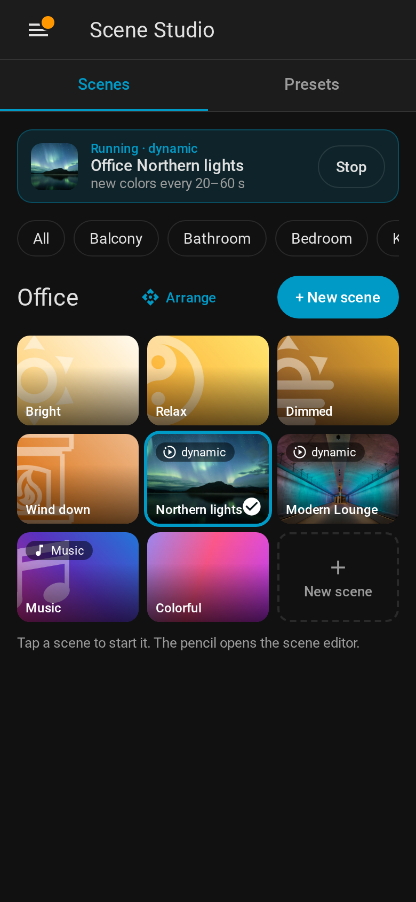

# Saved scenes

A saved scene stores a preset together with its lights and all settings (brightness, transition,
shuffle, dynamic mode incl. per-light timing, lights of the scene). Saved scenes are kept in Home
Assistant storage (`.storage/scene_studio.saved_scenes`) and survive restarts.

Every saved scene is also a **scene entity** (e.g. `scene.living_room_relax`) with the preset
picture as entity picture. Turning it on (`scene.turn_on`, a dashboard tile, the
[room card](Room%20card.md), a voice command) activates the saved scene. Renaming a saved scene
keeps its entity ID. The area of the scene entity is the **room** of the scene in the panel and on
the room card.

The state of the scene entity is the time it was **last activated** – also when it was started with
`scene_studio.activate_saved_scene` (panel, buttons, automations); a lamp mode (`targets`) does not
count. Panel and room card outline that scene as the active one. Attributes: `saved_scene_id`,
`preset_id`, `dynamic`, `music` and `order` (position set with **Arrange** in the panel).

## In the panel



1. In the **Presets** tab choose the lights under **Apply to**, the mode (**Once** / **Dynamic**),
   the brightness and, under **More options**, shuffle, transition or the dynamic timing.
2. Tap presets to try them on the lights.
3. Click **Save as scene**. The scene editor opens with the last tapped preset and these settings.
   Enter a name, check the room and click **Save**.

Or click **New scene** in the **Scenes** tab; the dashed tile of a room starts with that room and
its lights. A new scene is named after room and preset (*Living room Relax*) until you type a name.
The **pencil** on a scene opens the scene editor. **Arrange** next to a room name sorts the scenes by
drag and drop, also for all rooms at once. Details: [Panel](Panel.md).

Each scene can set brightness per light, not control some lights, let lights join only if they are on and
control light groups as one light: [Lights of a scene](Lights%20of%20a%20scene.md).

## In automations

```yaml
action: scene.turn_on
target:
  entity_id: scene.living_room_relax
```

The scene editor shows the entity ID with a **Copy** button (*Use in automations*).

## Services

| Service                              | Fields                                                                                                  |
|--------------------------------------|---------------------------------------------------------------------------------------------------------|
| `scene_studio.save_scene`           | `name`, `preset_id`, `targets`, optional `id` (overwrite), `dynamic`, `exclude`, `keep_groups`, `optional`, `light_brightness` and all fields of `apply_preset` / `start_dynamic_scene` |
| `scene_studio.activate_saved_scene` | `id`, optional `dynamic` (override the saved mode), optional `targets` (apply to other lights)         |
| `scene_studio.delete_saved_scene`   | `id` (also removes the scene entity)                                                                    |

`activate_saved_scene` accepts an optional `dynamic` flag that overrides the saved mode:
`dynamic: false` applies a dynamic scene once with spread colors (and stops a dynamic scene that is
running on the same lights), `dynamic: true` starts a static scene as dynamic scene.

With `targets`, `activate_saved_scene` applies the scene to other lights – used for
[lamp modes](Lamp%20modes.md).

`save_scene` returns the stored scene (including its `id`) as response.
The websocket command `scene_studio/get_saved_scenes` lists all saved scenes.
All fields: [Services](Services.md).

## Example

```yaml
action: scene_studio.save_scene
data:
  name: Living room relax
  preset_id: e71b2ef3-1b15-4c4b-b036-4b3d6efe58f8
  targets:
    area_id: living_room
  dynamic: true
  interval_min: 20
  interval_max: 60
  transition_min: 5
  transition_max: 15
  exclude:
    - light.tv_ambilight
  light_brightness:
    light.living_room_strip: 20
```
