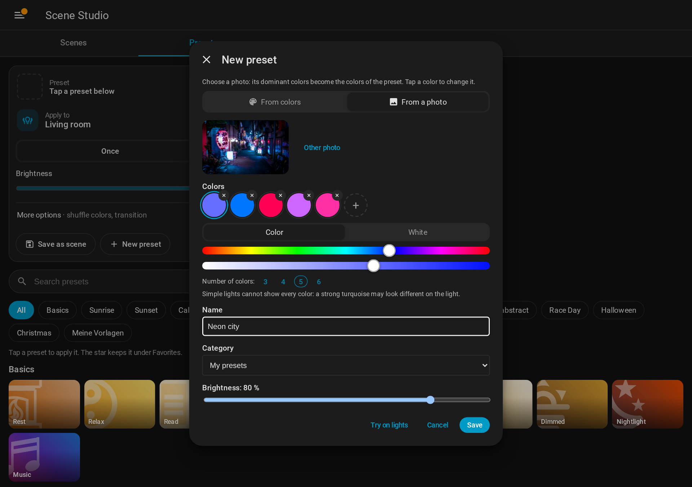

# Own presets – from colors or a photo

Create your own presets in the panel – from colors you pick or from a photo, no JSON, no restart –
and adjust or hide the built-in presets. Admin users only.

## New preset

Open the panel, tab **Presets**, and click **New preset**. Choose where the colors come from:

**From colors**

1. The preset starts with three colors. Tap a color to edit it below, **×** removes it, **+** adds
   one (up to six).
2. Each color has two tabs, like the Hue app: **Color** (hue and saturation) and **White** (warm to
   cool, 2000–6500 K, with quick choices). A white tone is stored exactly, so lights that only do
   color temperature get that very tone.
3. The picture of the preset is made from the colors: a soft gradient. It is renewed when you change
   the colors later.

**From a photo**

1. **Choose photo** – on the phone also straight from the gallery or the camera.
2. The browser picks the dominant colors of the photo (3 to 6, see *Number of colors*). Greys,
   near black and near white are skipped, pale colors are made a bit stronger, so the light does
   not look washed out. One-colored photos give fewer colors instead of near duplicates.
3. Adjust the colors as above.

Then:

- **Try on lights** shows the colors on the lights chosen under **Apply to** (choose them in the
  *Presets* tab first). Lights without color support are skipped.
- Enter a name, choose a category (default *My presets*, or a new category) and the brightness,
  then **Save**. The preset shows up in its category right away.

The photo is stored at up to 1024 px as JPEG. Nothing leaves your Home Assistant: the colors are
picked in the browser.

## Edit or delete own presets

Every preset has a **pencil** on its tile (with a mouse it shows when you point at the tile, like the
favorite star). For own presets: change name, category, brightness,
colors or the picture (**Other photo**, then **Take colors from the photo** if the colors should
follow it; or switch to **From colors**). **Delete** removes the preset and its picture. A preset
that is used by a saved scene cannot be deleted – the message names the scenes.

## Change built-in presets

The **pencil** on a built-in preset changes its colors and its default brightness; its picture stays.
**Restore original** brings back the original colors and brightness. There are no copies: the preset
keeps its name and ID.

**Hide** takes a built-in preset out of the lists (presets tab and preset picker). Saved scenes that
use it keep working. Hidden presets are listed at the end of the presets tab under **Hidden presets**;
the eye on a tile shows it again.

Saved scenes and dashboards that use the preset show the change right away.

## Where it is stored

Everything lives in `custom_components/scene_studio/userdata/custom/` (kept by HACS updates):

- `presets.json` - the same file as for [hand-written custom presets](Custom%20Presets.md).
  Presets from the panel are normal entries; changes of built-in presets are stored under
  `overrides` (`{preset_id: {img, lights, bri, hidden}}`); presets made from colors carry `"generated": true`. Hand-written entries and unknown keys are kept.
  Before the panel changes the file for the first time, a copy is saved as `presets.json.orig`.
  A file that cannot be read is never overwritten.
- `assets/user/` - the pictures (unique file names, removed again when a preset is deleted or its
  picture replaced).

Your photos stay private: they are only served to logged-in users of Home Assistant
(`/api/scene_studio/image/...`). The panel and the scene entities get signed links to them that are
valid for a limited time and renewed automatically, the same way Home Assistant shows camera pictures.
The pictures of [hand-written custom presets](Custom%20Presets.md) are treated the same way; only the
pictures of the built-in presets are public files.

## Websocket commands (admin only)

| Command | Fields |
|---|---|
| `scene_studio/save_custom_preset` | `name`, `bri` (1-255), `lights` (`[{x, y}]`, 1-10), optional `preset_id` (edit), `image` (base64 or data URL, JPEG/PNG/WebP, max 4 MB), `generated` (picture made from the colors), `category_id` or `new_category`, `default_category_name` |
| `scene_studio/delete_custom_preset` | `preset_id` |
| `scene_studio/set_preset_image` | `preset_id` of a built-in preset, `image`, `lights` and/or `bri` (default brightness 1-255) |
| `scene_studio/reset_preset` | `preset_id` - restores the original (a hidden preset stays hidden) |
| `scene_studio/set_preset_hidden` | `preset_id` of a built-in preset, `hidden` (true / false) |
